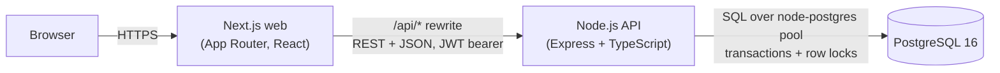
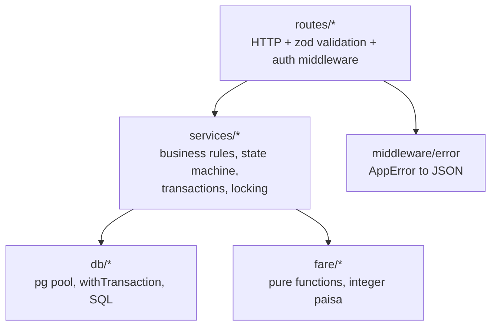
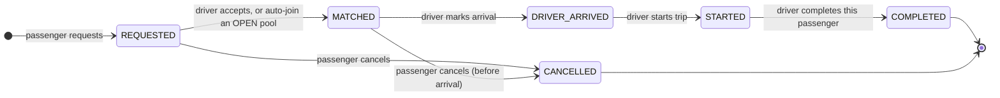
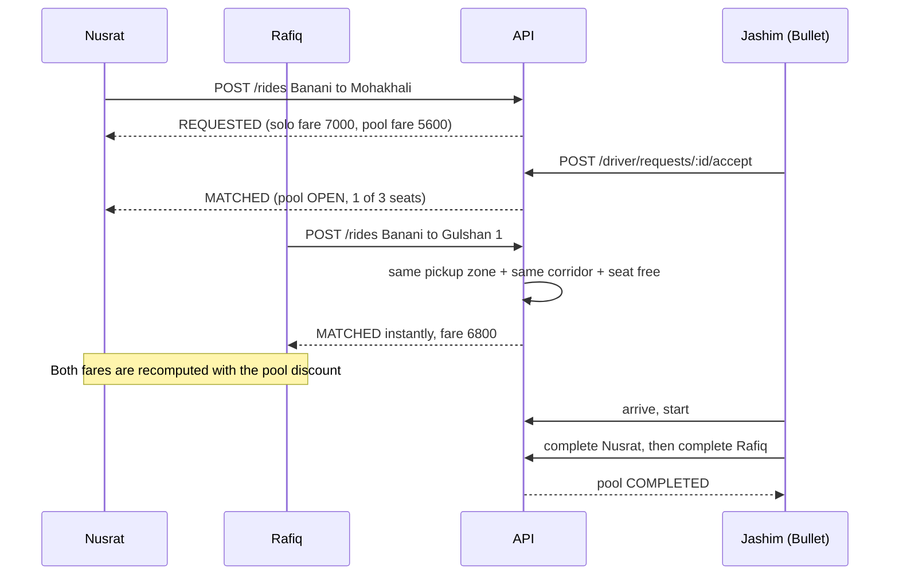

# Architecture

## System overview

Three deployable units, nothing else: `web`, `api`, `db`. No Redis, queues, or
microservices, because nothing in the MVP needs them. The "scale" section of the README
explains when each would earn its place.

The browser only ever talks to the Next.js origin. Next.js rewrites `/api/*` to the API
service, which avoids CORS and keeps the API URL out of client bundles.

## API layering

Rules live in services, not routes. Routes only parse, validate, authenticate and call a
service. The fare calculation is a pure function so it can be tested by hand.

## Ride and pool lifecycle

A **ride request** is one passenger's trip. A **pool** is one Tesla's current trip, and
holds one or more ride requests.

Pool status: `OPEN` (accepting riders) → `DRIVER_ARRIVED` (boarding closed) → `STARTED`
→ `COMPLETED`, or `CANCELLED` if every passenger cancels before arrival.

### Where this improves the suggested lifecycle

The brief suggests `REQUESTED → MATCHED → DRIVER_ARRIVED → STARTED → COMPLETED`. We keep
those names, with two deliberate changes:

1. **Arrive and start are pool-level, completion is passenger-level.** Nusrat gets off at
   Mohakhali while Rafiq continues to Gulshan 1. A single "complete trip" would either end
   Rafiq's ride early or keep Nusrat's fare open. The pool completes automatically when its
   last passenger completes.
2. **Boarding closes when the driver arrives.** No joins or cancellations after
   `DRIVER_ARRIVED`. This freezes pool membership, so fares are final once the driver is at
   the pickup and the pooled discount can never change mid-ride.

## Request flow: the Banani story

## Concurrency: the last seat

Bullet has one seat left. Nusrat and Shirin both try to claim it at the same instant.

**Current design (single Postgres, single API instance or many):**

1. Every join runs in one transaction and first takes `SELECT ... FROM pools WHERE id = $1
   FOR UPDATE`. The pool row is the serialization point for that Tesla.
2. After acquiring the lock it re-reads the pool, confirms it is still `OPEN`, and runs an
   atomic conditional update:
   `UPDATE pools SET occupied_seats = occupied_seats + $n WHERE id = $1 AND occupied_seats + $n <= seat_capacity`.
   Zero rows updated means no room, and the passenger stays `REQUESTED`.
3. `CHECK (occupied_seats BETWEEN 0 AND seat_capacity)` is a database backstop: even a
   future code bug cannot oversell the Tesla.
4. A partial unique index allows only one active pool per vehicle.
5. A partial unique index allows only one active ride per passenger, which also blocks
   double-submits.
6. Lock order is always **pool, then ride request**. Deadlock or serialization errors
   (`40P01`, `40001`) are retried up to three times.

**At larger scale:** matching would move to a geo-partitioned matching service with
per-region queues, so a Tesla's seat state has a single writer. Requests would carry an
idempotency key. See the scaling section in the README.
