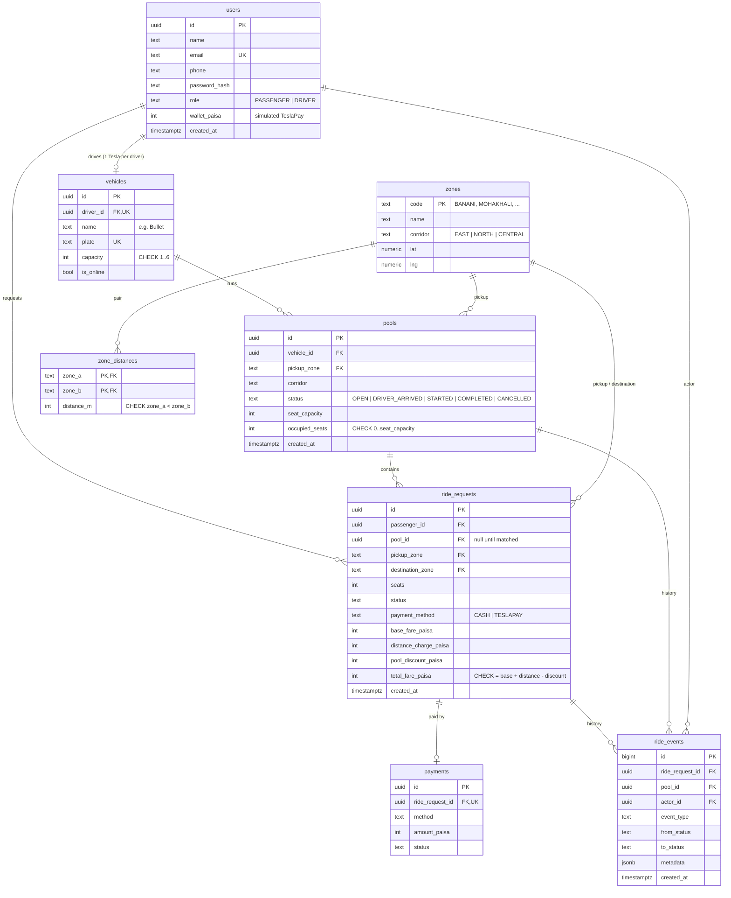

# Database design

PostgreSQL 16. Plain SQL migrations, no ORM. All money is `INTEGER` paisa.

## Tables

| Table | Why it exists |
|---|---|
| `users` | One table for passengers and drivers, split by `role`. Auth identity plus the simulated TeslaPay wallet balance. |
| `vehicles` | A Tesla with a fixed `capacity`. `driver_id` is unique, so one driver has one Tesla. `is_online` is the driver's availability. |
| `zones` | The predefined Dhaka areas. `corridor` drives the matching rule. Zone `code` is the key, so API payloads and seed data stay readable. |
| `zone_distances` | Hand-set road distances between zone pairs (metres), stored once per unordered pair. Makes the fare testable by hand. |
| `pools` | One Tesla's current trip. Carries `seat_capacity` (copied from the vehicle at creation) and `occupied_seats`, the field the capacity constraint protects. |
| `ride_requests` | One passenger's trip. Fare components are stored on the row, so a past ride is explainable even if pricing constants change. |
| `payments` | One payment record per completed ride (cash, or simulated wallet debit). |
| `ride_events` | Append-only history: every status change with actor, from, to, and metadata. This is what answers "what exactly happened?". A trigger blocks `UPDATE` and `DELETE`. |

## Constraints worth knowing

- `pools.occupied_seats BETWEEN 0 AND seat_capacity`: the capacity backstop.
- Unique index on `pools(vehicle_id)` where status is active: one live pool per Tesla.
- Unique index on `ride_requests(passenger_id)` where status is active: one live ride per
  passenger.
- `total_fare_paisa = base_fare_paisa + distance_charge_paisa - pool_discount_paisa`.
- `pickup_zone <> destination_zone`, `seats >= 1`.
- `REQUESTED` rides have no pool; `MATCHED`, `DRIVER_ARRIVED` and `STARTED` rides must have one.

## Indexes

| Index | Serves |
|---|---|
| `ride_requests(passenger_id, created_at DESC)` | Passenger history |
| `ride_requests(status, pickup_zone, created_at)` | Driver's list of open requests |
| `ride_requests(pool_id)` | Pool membership lookups |
| `pools(vehicle_id, created_at DESC)` | Driver history |
| `pools(pickup_zone, corridor)` where `status = 'OPEN'` | Auto-join candidate search |
| `ride_events(ride_request_id, created_at)` | Ride audit trail |
