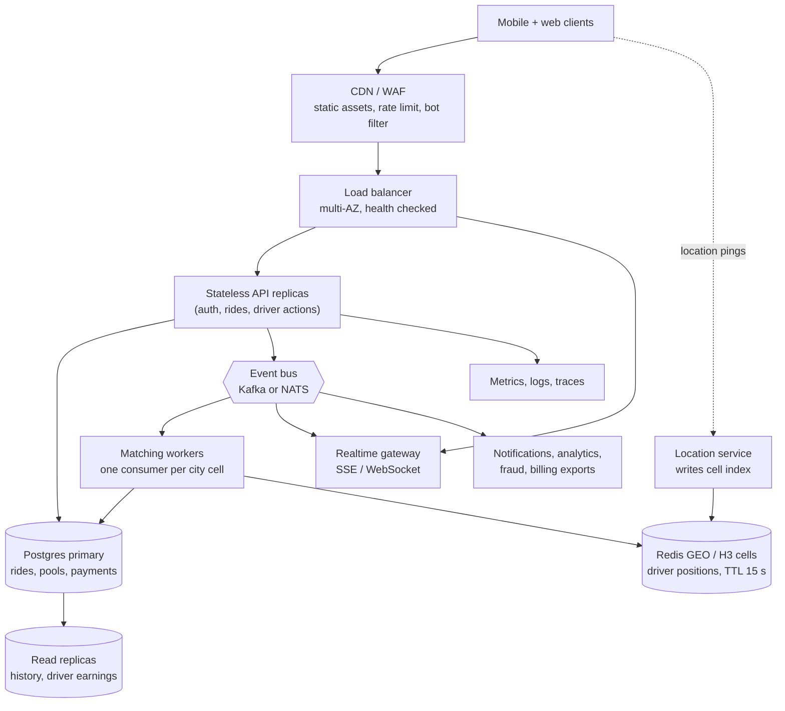

# If Oi Tesla goes viral

Target: **1 million passengers and 100,000 drivers**. This is reasoning, not an
implementation. The MVP deliberately has no Redis, queues or microservices, because one
Postgres handles the load it was built for. The point of this page is to show what breaks
first, in what order, and what we would add *only when it does*.

## 1. Estimate before designing

Assumptions (all adjustable): 1M registered passengers, 100k drivers, evening peak with
10% of passengers requesting within an hour.

| Quantity | Estimate | Consequence |
|---|---|---|
| Ride requests at peak | 100k per hour, about 28 per second | Small. One primary Postgres is fine for the *ride* data. |
| State changes per ride | about 8 events (request, match, arrive, start, completes, payment) | About 220 writes per second. Still fine on one primary. |
| Driver location pings | 100k drivers x one ping per 4 s = **25,000 per second** | This is the real problem. It must not touch Postgres. |
| Passenger status polling | 100k active riders x one poll per 3 s = about 33,000 per second | Second real problem. Polling must become push. |
| Hot rows | a Tesla has 3 seats; a *zone* can have thousands of requests | Contention is per zone, not per Tesla. |

So the scale problem is **ephemeral, high-frequency data** (location, status delivery) and
**matching in dense zones**, not the transactional ride data.

## 2. Target architecture

## 3. Topic by topic

**Load balancing.** The API holds no session state (JWT bearer), so any replica serves any
request. Put replicas behind an L7 load balancer across availability zones, with the
existing `/health` (liveness) and `/health/ready` (database reachable) probes. Drain
connections on `SIGTERM`; the server already shuts down gracefully.

**Horizontal scaling.** API replicas scale on CPU and request rate. The seat-claim logic
already works across replicas, because the lock lives in Postgres, not in process memory.
The Next.js tier scales the same way. Rate-limit state is per-process today and moves to
Redis (below).

**Database indexing, replicas and contention.**
- Indexes already match the hot queries: open requests `(status, pickup_zone, created_at)`,
  open pools `(pickup_zone, corridor) WHERE status='OPEN'`, passenger history, pool members.
- Add **pgBouncer** (transaction pooling) in front of Postgres: hundreds of API replicas
  must not each hold ten connections.
- **Read replicas** serve history and earnings screens. Seat claims and status transitions
  stay on the primary, because they need read-your-writes and locks.
- **Partition `ride_events` by month** (append-only, time-ordered), and archive old
  partitions. Everything else stays small because finished pools leave the hot indexes.
- Contention is bounded: a claim locks one *pool* row, so two Teslas never block each
  other. The real hot spot is many requests competing for the same few open pools in one
  zone, which is solved by matching in batches (below), not by a bigger database.

**Caching.** Zones and distances are static: cache in process (they are tiny). Driver
presence and position live only in Redis with a short TTL, so "online" decays on its own
when the app dies. Never cache fare *results* that depend on pool membership.

**Geospatial search.** Replace "same pickup zone" with a spatial index. Start with
**PostGIS** (`ST_DWithin` on a GiST index) if volume allows. At 25k pings per second use
**H3 or geohash cells in Redis GEO**: a request looks up its own cell and neighbours for
candidate Teslas. The matching *rule* (same pickup area, compatible route, free seats) stays
the same function. Only candidate lookup changes.

**Queues and events.** Today the request path does matching inline in one transaction,
which is correct and simple. At scale, `RideRequested` goes onto a bus partitioned by
**city cell**. One consumer per cell means **a single writer per Tesla's seat state**, which
removes most lock contention and lets us batch: collect requests for 1-2 seconds and solve
the small assignment problem together instead of first-come-first-served. Use the
**outbox pattern** (write the event in the same transaction as the state change) so events
are never lost or phantom. Consumers must be idempotent.

**Real-time communication.** Replace 3-second polling with **SSE** (one-way status pushes,
works through proxies, trivial to scale) or WebSockets if bidirectional chat is added. A
realtime gateway subscribes to the bus and pushes `ride.updated` to the right user.
Keep one cheap `GET` as the fallback and the source of truth after reconnects.

**Rate limiting.** Edge limits per IP at the CDN/WAF; per-user token buckets in Redis for
ride requests and auth (the auth limiter in `routes/auth.ts` is the in-process prototype).
Return `429` with `Retry-After`. The one-active-ride-per-passenger unique index already caps
request spam at the data layer.

**Idempotency.** Mobile networks retry. Accept an `Idempotency-Key` header on `POST /rides`
and driver actions, store the key with the response for 24 hours, and return the original
result on replay. Today the partial unique index turns a double submit into a clean 409;
the key makes the retry succeed instead of failing.

**Retries and failure strategy.** Already present: the transaction helper retries deadlock
and serialization errors with a bound. Add: exponential backoff with jitter on client
calls; a driver heartbeat, and if a driver goes silent for N seconds their `OPEN` pool is
cancelled and passengers re-queue (the `REQUESTED` re-queue path exists today for driver
cancellation); a dead-letter queue for poison events; circuit breakers around the payment
provider. Money movement becomes a **saga** with compensation, not a single transaction.

**Observability.** Structured JSON logs with request ids exist. Add RED metrics per route,
traces across API, bus and workers, and product SLOs: time-to-match p95, seat-claim
conflict rate, percentage of rides re-queued, cancel rate by stage. Alert on SLO burn, not
on CPU.

**Security.** Move tokens to short-lived access + rotating refresh in `httpOnly` cookies
(localStorage is an XSS risk accepted for the MVP). Secrets from a secrets manager.
Per-role scopes, driver KYC and device binding, WAF and bot detection, TLS everywhere,
dependency and image scanning, and the append-only `ride_events` table as the audit trail.
Privacy: passengers already never see each other's identity or fare.

**Deployment strategy.** Containers on a managed orchestrator across at least two AZs.
Blue/green or canary releases behind a feature flag. Database migrations use
**expand, migrate, contract** so old and new code run side by side. Per-city cells later:
each city is an independent stack, so a failure in Dhaka never affects Chattogram.

## 4. Build order if it really happened

1. PgBouncer, read replicas for history, rate limiting in Redis. (Days.)
2. SSE for status instead of polling. (Biggest drop in request volume.)
3. Location service with Redis GEO, drivers' `is_online` driven by heartbeat.
4. Bus and per-cell matching workers, batched matching.
5. Idempotency keys, outbox, event consumers.
6. Partition `ride_events`; city cells.

## 5. What we are deliberately not doing now

Kubernetes, Kafka, microservices and Redis are all absent from the MVP. Each one has a
named trigger above (location write volume, polling volume, per-zone contention). Adding
them earlier would only add failure modes and ops cost without a measured reason.
